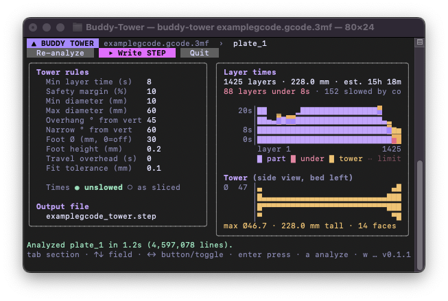

# Buddy Tower

**Minimum layer time cooling tower generator for Bambu Studio and OrcaSlicer.**



Small, fast layers print badly on a 3D printer because they don't get time to cool. Instead of
letting the slicer slow down, Buddy Tower reads a sliced `.gcode.3mf` from Bambu Studio or
OrcaSlicer, works out how long every layer takes, and designs a round sacrificial tower to print
next to your part. The tower gets wider where the part's layers are fast, so every layer takes at
least your minimum layer time.

You get a STEP file. Drop it on the same plate and re-slice.

## Download

Grab the build for Windows, macOS or Linux from
[Releases](https://github.com/mmmlinux/Buddy-Tower/releases), or build it yourself with Go 1.24.2
or newer (any Go from 1.21 on will download 1.24.2 for you automatically):

```sh
go build -o buddy-tower .
```

Pick `x86_64` for most PCs, `arm64` for ARM machines and Apple Silicon Macs, and `intel` for
Intel Macs. If macOS blocks the download, run `xattr -d com.apple.quarantine buddy-tower`.

## Use

```sh
./buddy-tower model.gcode.3mf
```

Pick a plate if there's more than one, let it analyze, adjust the tower rules if you like, then
press **Write STEP**.

- `tab` / `shift+tab`: switch section
- `↑↓`: move between fields
- `←→`: move along the buttons, flip toggles
- `enter`: press a button
- `q`: quit

To skip the interface and just write the STEP:

```sh
./buddy-tower model.gcode.3mf -step
```

| Flag | What it does |
|---|---|
| `-min-time 10` | Minimum layer time in seconds (default: the slicer's own setting) |
| `-out tower.step` | Where to write the STEP (default: next to the 3MF) |
| `-plate plate_2` | Which plate to use when there are several |
| `-step` | No interface, just write the STEP |
| `-dump` | Print a per-layer CSV of times |

## License

Free to use, modify and share under the MIT License with the Commons Clause: you may not sell it,
or sell a product or service whose value comes mainly from it, without permission. See
[LICENSE](LICENSE). Third-party libraries are listed in [THIRD_PARTY_NOTICES.md](THIRD_PARTY_NOTICES.md).
